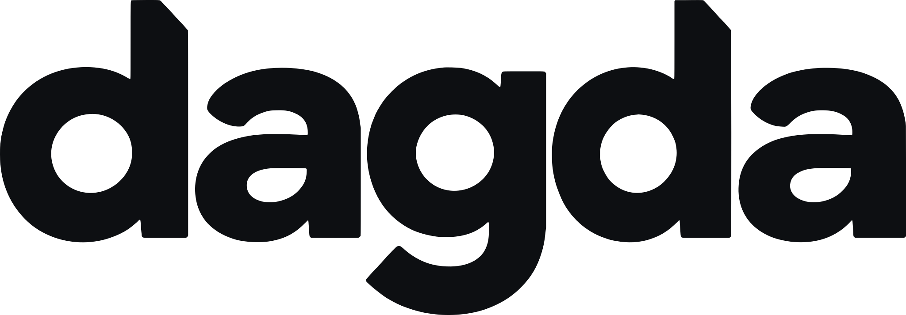

<h1>
  <picture>
    <source media="(prefers-color-scheme: dark)" srcset="assets/brand/dagda-wordmark-dark.svg">
    
  </picture>
</h1>

Dagda is an experimental native UI framework for Odin, designed for applications that people and agents can operate together. In a slide editor, the headline on the canvas and the title in the outline represent the same object. The goal is for a person to edit it in either view, for an agent to propose a rename while the person works, and for either of them to undo the change.

**New here?** [Build your first native Dagda app](docs/first-app.md) — a counter window from your own Odin project, clicked once by hand and once by an agent.

Today, on Linux and on Apple Silicon macOS, one SDL3 window shows an editable slide title backed by a shared title model, and a terminal client can inspect, preview, and commit a rename over a local socket while a second client watches committed changes. Typing, text composition, and keyboard undo in the window operate on the same model, and the window keeps keyboard focus when an external edit lands.

## Quick start

From a clean checkout on Linux x86-64 or macOS on Apple Silicon (arm64) you need the tools the pinned Odin installer uses (Python 3, curl, tar) plus SDL3, FreeType, and a sans-serif TrueType font:

```sh
# Debian / Ubuntu
sudo apt-get install -y python3 curl tar libsdl3-dev libfreetype-dev fonts-liberation
# Arch Linux:  pacman -S python curl tar sdl3 freetype2 ttf-liberation
# Fedora:      dnf install python3 curl tar SDL3-devel freetype-devel liberation-sans-fonts
# macOS (Apple Silicon): brew install sdl3 freetype
#   (the setup the macOS CI job uses; Python 3, curl and tar come
#    with the Xcode Command Line Tools or Homebrew, and the host
#    finds a system font, so no font package is needed)

bash scripts/setup-odin.sh   # installs the pinned Odin compiler from dagda.lock (macOS ARM64 on Apple Silicon)
mkdir -p build
./scripts/odin.sh build examples/title-window -collection:dagda=. -out:build/title-window
./scripts/odin.sh build examples/title-driver-client -collection:dagda=. -out:build/title-client
```

Then use two terminals. In **Terminal 1**, create a fresh private socket directory, print the copyable socket assignment, and start the window:

```sh
SOCK_DIR=$(mktemp -d /tmp/dagda-title.XXXXXX)
SOCK=$SOCK_DIR/title.sock
echo "SOCK=$SOCK"
./build/title-window --socket "$SOCK"
```

The `echo` prints one line like `SOCK=/tmp/dagda-title.AbCdEf/title.sock`, and the window then prints `Listening /tmp/dagda-title.AbCdEf/title.sock`. Leave the window running.

In **Terminal 2**, paste the exact `SOCK=...` line Terminal 1 printed (your directory name will differ), start the watcher, and wait until it prints the revision-0 snapshot before running the edit commands in the same terminal:

```sh
SOCK=/tmp/dagda-title.AbCdEf/title.sock   # paste the line Terminal 1 printed
./build/title-client "$SOCK" watch slide.title &
# wait for this snapshot to print before continuing:
# {"ok":true,"id":1,"revision":0,"text":"Quarterly results","role":"slide.title"}

./build/title-client "$SOCK" inspect slide.title
./build/title-client "$SOCK" preview 1 0 "Revenue grew 12%"
./build/title-client "$SOCK" commit 1 0 "Revenue grew 12%"
# the watcher prints: {"event":"commit","id":1,"revision":1,"text":"Revenue grew 12%"}
```

Now click the title in the window if it is not already focused and press **Ctrl+Z** (on macOS, **Cmd+Z**). The window restores “Quarterly results”, keeps keyboard focus, and the watcher in Terminal 2 prints:

```json
{"event":"undo","id":1,"revision":2,"text":"Quarterly results"}
```

To clean up, close the window. The window removes its own socket file on shutdown, the watcher sees the connection close (EOF) and exits on its own, and Terminal 1 — which still has `SOCK_DIR` set — can then remove the empty directory:

```sh
# Terminal 1, after closing the window:
rmdir "$SOCK_DIR"
```

A preview never changes the document, and a commit based on an old revision is rejected with `Stale_Revision` and the current revision, so a person's edit made between preview and commit always survives.

## Headless example

The same model also runs without a window. From the repository root:

```sh
./scripts/odin.sh run examples/shared-title -collection:dagda=.
```

The example starts with a known title, prints its role and ID, and tries two edits based on revision zero.

```text
Inspect  slide.title #1 at revision 0: Quarterly results
Preview  Revenue grew 12% (document still reads "Quarterly results")
Commit   revision 1: Revenue grew 12%
Retry    Stale_Revision (document still reads "Revenue grew 12%")
```

## Read the Odin

The example discovers the title by its semantic role. Dagda supplies the target, which carries the discovered object ID and the document revision the caller saw. The title model owns both strings.

```odin
snap := title_model.snapshot(&model)
objects := [1]dagda.Object_Info{snap.object}
ids: [1]dagda.Object_Id
written, total := dagda.find_by_role(objects[:], "slide.title", ids[:])
if written != 1 || total != 1 {
	panic("Expected exactly one slide.title object")
}

target := dagda.Action_Target{id = ids[0], base_revision = snap.revision}
```

A preview clones the proposed text into storage the preview itself owns, so the document still reads the old title and discarding the preview changes nothing. Commit checks the ID and revision before installing its own copy of the new text.

```odin
p, preview_err := title_model.preview(&model, target, "Revenue grew 12%")
if preview_err != .None {
	panic("Example preview failed")
}
defer title_model.preview_destroy(&p)
fmt.printf("Preview  %s (document still reads %q)\n", p.text, title_model.snapshot(&model).text)

if err := title_model.commit(&model, target, "Revenue grew 12%"); err != .None {
	panic("Example commit failed")
}
```

In the final line of the demo, retrying the original target returns `Stale_Revision`. Checking the revision before writing gives the caller a chance to read the new headline and reconsider its edit. [Full example](examples/shared-title/main.odin) · [Title model](examples/title-model/title_model.odin) · [Title window](examples/title-window/README.md) · [Local driver](examples/title-driver/README.md) · [Dagda core](dagda/core.odin)

## Where this goes next

The desktop API keeps an object's meaning alongside its geometry. A chart can expose its series and layout constraints. A view can report where the legend landed and whether a label was clipped. An agent editing the chart could inspect the series, invoke a typed action, and check a rendered preview. An agent testing the UI could reach the same action through keyboard input or a drag. Each window would keep its own focus, selection, and text composition.

This design draws on GPUI's custom native views, focus handling, and typed actions, and on Exact's driver for inspecting and exercising a running app. [GPUI](https://github.com/zed-industries/zed/tree/main/crates/gpui) · [Exact’s agent loop](https://github.com/expo/exact#the-agent-loop)

Broader widgets, other native hosts (macOS and Windows), rich text, and a general inspector remain future work; the Linux window, local driver, and shared undo above are the first working slice.

## License

Dagda is licensed under the [Apache License, Version 2.0](LICENSE).
