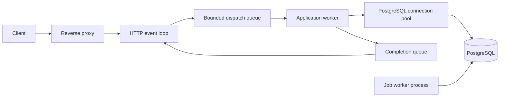

# Dagda Backend Framework Specification

Date: 2026-11-06

Status: architecture proposal; [M0 implementation in progress](docs/M0.md)

Confirmed decisions: name Dagda, implementation language Odin, backend-only scope

Dagda will provide a complete path from a new Odin project to a deployed, database-backed API. Its central promise is that routine backend capabilities work together: routing, data access, validation, authentication, durable jobs, testing, and deployment share consistent conventions.

This specification defines the intended behavior. No framework implementation exists yet. The first release is a narrow, usable alpha; production readiness depends on the runtime and failure tests described below.

## Product goals

Dagda serves developers building APIs for browser applications, mobile clients, internal tools, and integrations. The initial reference application is a small invoicing API with users, accounts, invoices, and a background job that records a delivery request.

The design should make ordinary application work predictable:

1. Create an application with a working structure and explicit configuration.
2. Generate a resource with a migration, input types, repository procedures, routes, and tests.
3. Express business operations as ordinary Odin procedures with explicit errors and transactions.
4. Authenticate a caller and apply an application-owned authorization policy.
5. Commit an application change and a background job atomically.
6. Build an artifact that can run the server, migrations, or workers without a compiler.

Backend-only excludes page rendering, components, browser state, asset pipelines, and frontend build tooling. Authentication for a browser client remains in scope. Documentation generation can produce OpenAPI files without introducing a frontend framework.

## Reference application

The reference API uses the same public framework interfaces available to generated applications. It has no privileged shortcuts into framework internals.

| Endpoint | Behavior |
| --- | --- |
| `GET /auth/csrf` | Establish a short-lived pre-authentication session and return its CSRF token for the browser login flow |
| `POST /auth/login` | Verify credentials, rotate the session, and return the authenticated user and a fresh CSRF token |
| `POST /auth/logout` | Revoke the current session and expire its cookie |
| `GET /auth/me` | Return the authenticated user |
| `GET /api/v1/invoices` | Return a cursor-paginated list scoped to the caller's authorized account |
| `POST /api/v1/invoices` | Validate input, insert an invoice, and enqueue a delivery-record job in one transaction |
| `GET /api/v1/invoices/:id` | Return an invoice only after checking account access |
| `PATCH /api/v1/invoices/:id` | Apply explicitly supplied fields under a revision check |
| `DELETE /api/v1/invoices/:id` | Delete the reference resource under its authorization policy |

Invoice creation accepts `title` and `total_cents`; it derives account ownership from the authorized request context. IDs, timestamps, ownership fields, and revision values are server-controlled. Success returns 201 with the invoice object and a Location header. A validation failure changes neither invoices nor jobs. A job records a simulated delivery with a unique invoice/event key, allowing retry tests without a real email provider. Production invoicing rules, accounting behavior, and deletion policy are outside this reference app.

Generated request tests first establish identity and account membership, then exercise creation, validation, revision conflicts, and cross-account denial. Generic generated policies deny by default; the reference app supplies its concrete policy.

## Proposed defaults

| Decision | Initial choice | Reason |
| --- | --- | --- |
| Language | Odin, confirmed | Preserve the original project direction |
| HTTP foundation | Pinned `laytan/odin-http`, subject to the runtime proof | Reuse existing protocol work behind a narrow adapter |
| Database | PostgreSQL through libpq | Reuse the established PostgreSQL client implementation |
| Application handlers | Sequential procedures on a bounded worker pool | Keep business code straightforward while isolating blocking work |
| Data access | Parameterized SQL, typed mapping, generated repositories | Make queries and transaction boundaries visible |
| Temporary memory | One owned arena per active request or job | Reclaim ordinary temporary data as a unit |
| Authentication | Database-backed opaque sessions and API tokens | Support expiry and revocation without a JWT requirement |
| Background jobs | PostgreSQL queue, separate worker process | Share infrastructure and enable transactional enqueue |
| Production | Linux behind a reverse proxy | Keep the initial operating environment focused |
| Packaging | Native application plus declared native-library dependencies | Avoid promising a fully static binary before proving the build |
| Dependency management | Vendored sources, pinned revisions, supported compiler version | Make application builds reproducible |

Odin has explicit allocator support and runtime reflection, which can support these conventions. Its FAQ recommends pinned, vendored dependencies. Sources: [language overview](https://odin-lang.org/docs/overview/), [package policy](https://odin-lang.org/docs/faq/#is-there-an-official-odin-package-manager).

The `odin-http` README describes the library as a proof of concept that is not intended for production and warns about compatibility changes. Dagda must maintain its chosen revision and validate its behavior; an adapter alone does not establish production readiness. [HTTP dependency](https://github.com/laytan/odin-http).

## Release scope

| Capability | Version 0.1 alpha | Version 0.2 target |
| --- | --- | --- |
| HTTP | Routing, middleware, JSON, limits, deadlines, stable error bodies | Streaming and multipart uploads after ownership tests |
| Database | Pooling, SQL parameters, typed rows, transactions, migrations, seeds | Better query generation and explicit relationship helpers |
| Validation | Required fields, ranges, lengths, enums, custom procedures | Expanded reusable validators and schema tooling |
| Authentication | Password login, revocable sessions, opaque API tokens, policy hooks | Email verification, password reset, extensible identity providers |
| Jobs | Durable enqueue, leases, retries, delayed execution, inspection | Recurring schedules and queue administration improvements |
| Developer tools | New project, resource generator, watch/restart, tests, build, doctor | Upgrade tooling and improved diagnostics |
| Operations | JSON logs, request IDs, health/readiness, basic metrics, drain | Trace export and expanded operational integrations |
| Integrations | Outbound HTTP wrapper with explicit timeouts | Mail delivery with a development outbox and one provider; object storage |
| API documentation | Typed declarations and documented endpoint contracts | OpenAPI export from the shared declarations |

Version 0.1 must complete the vertical slice across these areas rather than expose many placeholder packages. Version 0.2 is the target for the broader batteries-included offering. A feature is not supported merely because an interface or package exists.

## Application and CLI

The development CLI is named `dagda`. The generated application is compiled from ordinary Odin packages. The CLI invokes the pinned toolchain and app commands rather than duplicating application behavior in a separate runtime.

| Command | Contract |
| --- | --- |
| `dagda new NAME` | Generate a runnable app, tests, configuration example, and local PostgreSQL Compose file; never overwrite an existing project |
| `dagda doctor` | Check compiler version, dependency revisions, native libraries, configuration, and optional database connectivity without printing secrets |
| `dagda db setup` | Explicitly start the generated local database configuration when Docker is available, then invoke migrations and development seeds |
| `dagda generate resource NAME FIELDS` | Create migration, separate input/output types, repository, handlers, policy stub, route registration, and meaningful request tests |
| `dagda generate migration NAME` | Create a numbered SQL migration template |
| `dagda db migrate` | Build the app when needed and run pending migrations |
| `dagda db status` | Show applied and pending migrations and checksum mismatches |
| `dagda db seed` | Run explicit, repeatable development seed procedures |
| `dagda dev` | Watch, compile, and restart; show compile errors while retaining the last working process until a replacement builds |
| `dagda test` | Run Odin tests and requested database/request integration suites |
| `dagda routes` | List methods, paths, handlers, and declared access policies |
| `dagda build --release` | Build the app and emit dependency/version metadata and a container recipe |
| `dagda jobs list`, `dagda jobs retry ID` | Inspect job state and explicitly retry a selected failed job through app commands |

Generators support a preview mode and refuse file collisions. Irregular plural names can be specified explicitly. Generated source belongs to the application and is not overwritten by future builds. Build-derived registries are separate and replaceable.

The application executable exposes `serve`, `worker`, `migrate`, and administrative subcommands used by the CLI. Production migrations run as an explicit deployment step before compatible application processes start. Startup does not silently alter the schema.

Proposed application structure:

```text
billing/
  cmd/billing/main.odin
  app/bootstrap.odin
  config/config.odin
  resources/invoices/
    types.odin
    repository.odin
    handlers.odin
    policy.odin
    routes.odin
  services/
  jobs/
  db/migrations/
  db/seeds/
  tests/
  vendor/dagda/
  dagda.lock
  .env.example
  compose.yaml
```

Resource directories are Odin packages with unique package names. App bootstrap explicitly registers resources, services, and job handlers. There is no runtime filesystem scan or dynamic class loading. Library dependencies flow toward the runtime and data primitives; application packages must not introduce circular imports.

## Runtime and request ownership

The HTTP adapter owns sockets, parsing, connection state, and response transmission. Application workers own handler execution and blocking database work. Worker threads must not invoke HTTP operations that require the originating event-loop thread.



The request lifecycle is:

1. Parse and validate framing under header, body, connection, and time limits; reserve a body-memory budget before buffering a body.
2. Reserve dispatch and completion capacity and construct an owned request snapshot. Copy any transport buffers that may be reused; never hand a worker borrowed parser memory.
3. Transfer exclusive access to the request state and arena to a worker.
4. Decode input, authenticate, authorize, execute application procedures, and construct the response.
5. Return a completion message to the originating HTTP event loop.
6. Transmit the response and release request storage only when the worker and transport can no longer reference it.

A client disconnect signals cancellation but does not free storage still used by a worker or database operation. Cancellation is cooperative; a deadline cannot safely terminate arbitrary Odin code. The runtime tracks worker completion and transport completion separately.

Each admitted request reserves room for its completion so a full completion queue cannot deadlock all workers. Connection count, aggregate buffered bytes, response size, and idle/write timeouts are bounded independently of handler count. Slow readers and idle keep-alive connections must not hold application worker threads.

The request arena is the default allocator for request-owned framework results. Shared caches, connection pools, and queues use separate allocators. Async handoffs propagate the intended Odin context explicitly. Job payloads are serialized before enqueue; caches copy retained values. Persistent containers must never capture a request allocator.

Streaming and WebSockets need a separate connection/session lifetime and are deferred beyond the alpha. The framework does not promise recovery from arbitrary panics, invalid memory access, or process corruption. Expected application errors are returned explicitly; process supervision handles crashes.

The first milestone must prove cross-thread completion and safe cancellation against the pinned HTTP library. If its public API cannot support them, implement and test a small maintained patch or select another HTTP foundation before freezing handler APIs. Keep the language decision unchanged.

## HTTP and API contracts

The request context contains method, normalized route parameters, headers, query fields, body access, request ID, deadline, application services, authenticated principal, and request-owned storage. Middleware and handlers are ordinary Odin procedures with explicit state pointers; capturing closures are not assumed.

Middleware ordering is defined: request metadata and limits, CORS handling, route matching, authentication and CSRF where applicable, authorization, handler execution, response finalization, and access logging. Every completion path emits one access record.

Input types are distinct from database records. Request decoding never binds arbitrary client fields into persistent objects. Unknown fields are rejected by default. Partial updates distinguish omitted fields from explicit nulls and zero values. Content type, syntax, and business validation are separate checks.

| Condition | HTTP status |
| --- | --- |
| Malformed request or JSON | 400 |
| Deadline exceeded while receiving a request | 408 |
| Missing or invalid authentication | 401 |
| Denied operation | 403, or an explicitly configured 404 concealment policy |
| Missing resource | 404 |
| Unique constraint or optimistic concurrency conflict | 409 |
| Request body too large | 413 |
| Unsupported request content type | 415 |
| Valid JSON with invalid field values | 422 |
| Client rate limit exceeded | 429 |
| Capacity exhausted or required dependency unavailable | 503 |
| Unexpected internal failure | 500 with no internal details |

An application deadline exceeded before response transmission maps to a stable `deadline_exceeded` error with status 503. After transmission starts, a timeout closes the response/connection rather than attempting a second status line. Rate and capacity responses supply Retry-After when a useful retry interval is known.

Error responses use one documented JSON envelope:

```json
{
  "error": {
    "code": "validation_failed",
    "message": "Request validation failed",
    "fields": { "title": ["required"] }
  },
  "request_id": "example-request-id"
}
```

Successful single-resource responses are objects. Collections contain `data` and `next_cursor`; clients do not receive implicit total-count queries. Generated list endpoints use a deterministic cursor order, bounded page sizes, and allowlisted sort/filter fields.

Initial configurable defaults are a 1 MiB buffered body limit, 16 KiB aggregate header limit, 30-second request deadline, 10-second database statement timeout, 2-second pool acquisition timeout, maximum page size 100, and 30-second shutdown grace. Effective operation deadlines cannot exceed the remaining request deadline. These are proposed starting values to validate in the runtime milestone, not measured capacity guarantees.

## PostgreSQL and migrations

Dagda wraps libpq with bounded connection pools and explicit connection ownership. Each transaction holds one leased connection until commit or rollback. Pool acquisition has a deadline; excess work is rejected rather than queued indefinitely. Workers and HTTP processes use separate pool budgets so background load cannot consume every application connection.

Connection establishment, queries, and result retrieval need bounded waits as well as PostgreSQL statement timeouts. The runtime proof must verify cancellation during an active query and loss of network connectivity. A canceled or failed connection is returned to the pool only after protocol and transaction state are clean; otherwise it is discarded. A database statement timeout alone does not establish an end-to-end network deadline.

Queries use positional parameters. Dynamic table/column identifiers come from validated application declarations, never direct client interpolation. Query helpers accept a transaction handle so business operations and job enqueue can share a commit.

Rows are copied into the caller's allocator before libpq result storage is released. Initial mappings cover integers, booleans, text, UUIDs, timestamps, binary data, JSONB, and nullable values. Decimal database values preserve exact representation rather than silently becoming floating-point values. Unsupported mappings return an explicit error. Large result sets are limited; streaming results require a later ownership contract.

Odin structs and generated repository procedures provide typed results. The alpha does not claim that arbitrary SQL is type-checked by the Odin compiler. Schema compatibility is checked through migrations and integration tests. Relationships use explicit queries; there is no automatic lazy loading, dirty tracking, or callback-driven persistence.

New resource templates default to UUID identifiers and UTC timestamps, with database uniqueness, foreign keys, and check constraints where declared. Business constraints remain authoritative in the database even when an input validator duplicates them for better errors.

Migrations are ordered SQL files with recorded checksums in a framework-owned table. One migrator runs at a time under a database lock. Each migration runs transactionally where supported; operations requiring nontransactional execution must declare that fact. A failed migration stops the run, and checksum changes to applied migrations fail verification. Rollbacks require an explicit reversible down migration; backups and data recovery are separate operational responsibilities.

Connection failures during a transaction do not trigger invisible retries. If commit succeeds but the reply is lost, the application may face an unknown outcome. Dagda surfaces that condition, discards unusable connections, and lets business idempotency or reconciliation resolve it. [libpq interfaces](https://www.postgresql.org/docs/current/libpq-async.html).

## Authentication and authorization

The alpha includes an opt-in account module with user creation, password login/logout, current-user lookup, session revocation, and API-token issuance/revocation. Self-service registration is off until the application enables it and chooses abuse controls. The alpha does not claim a complete public account lifecycle; reset and verification arrive with mail integration.

Passwords use Argon2id through an existing, reviewed implementation. Cost settings are versioned and benchmarked on supported hosts; password hashing has its own concurrency bound. Login errors do not disclose whether an account exists. [Password storage guidance](https://cheatsheetseries.owasp.org/cheatsheets/Password_Storage_Cheat_Sheet.html).

Sessions and API tokens contain high-entropy opaque secrets generated by the OS CSPRNG. The database stores a one-way digest for lookup rather than the bearer secret. Session records contain owner, expiry, revocation state, and rotation metadata. Authentication rotates the session identifier. Logout and password changes invalidate relevant sessions.

Browser sessions use HttpOnly, Secure cookies in production with an explicit SameSite policy. Cookie-authenticated unsafe requests require CSRF protection, including the login flow. SameSite is supplemental. API tokens use the Authorization header; tokens never appear in URLs or logs. [Session guidance](https://cheatsheetseries.owasp.org/cheatsheets/Session_Management_Cheat_Sheet.html).

Routes declare accepted authentication modes. Ambiguous simultaneous cookie and bearer credentials are rejected rather than silently selecting a different principal. The pre-authentication CSRF bootstrap is read-only apart from creating its bounded, expiring session; login validates that token before rotating the session. The account module provides authenticated password-change behavior without exposing a public reset flow in the alpha.

CORS is closed by default and uses an explicit origin allowlist. Forwarded headers are trusted only from configured proxy addresses. Authentication endpoints have request and hashing limits; alpha in-process rate limits apply per instance, with shared edge enforcement documented for multiple instances.

Every route declares public access or an authentication/policy requirement. A generated resource defaults to denied access until its policy is implemented. Authentication establishes identity; resource ownership and tenant access remain explicit application predicates. The reference app tests cross-account access failures.

## Durable jobs

PostgreSQL stores job name, payload version, serialized payload, state, scheduled time, attempt count, lease token and expiry, and bounded error metadata. Enqueue can participate in the caller's transaction, so rolling back the application change also removes the job.

Workers claim eligible rows in short transactions using `FOR UPDATE SKIP LOCKED`, assign a lease, commit, and execute outside the database transaction. Acknowledgment and lease renewal require the current lease token. The mechanism is intended for queue-style consumers. [PostgreSQL locking documentation](https://www.postgresql.org/docs/current/sql-select.html).

The delivery contract is **at least once**. A worker can perform an external side effect and crash before recording success. Handlers must use idempotency keys or application constraints; a lease is not a guarantee of exactly-once external execution. A lease lost during execution can also permit overlapping attempts, so heartbeat and acknowledgment checks do not replace idempotency.

Retries use capped exponential backoff with jitter and a maximum attempt count. Exhausted jobs remain inspectable and can be retried explicitly. Payload versions support rolling deploys; unknown handlers or payload versions fail visibly without discarding work. Completed jobs have a configurable retention policy.

The alpha supports delayed jobs, worker concurrency limits, queue selection, listing, and manual retry. Recurring schedules and a web dashboard are later features. No Redis or broker is required for the default installation.

## Configuration and operations

Configuration is loaded once into typed application settings. Precedence is documented defaults, a development-only local environment file, process environment, and explicit command flags. Production requires its declared database credentials and secrets; development values never silently become production defaults. Logs redact authorization headers, cookies, passwords, connection strings, and configured sensitive fields.

Liveness reports process availability. Readiness reports startup completion, drain state, compatible schema, and a bounded database health check. Metrics cover request count/duration, active workers, queue depth, database pool waits, and job outcomes, with bounded labels based on route templates. Administrative endpoints bind to an internal listener or require an explicitly protected deployment configuration.

SIGTERM stops new work, drains active requests/jobs until the configured deadline, and exits. Interrupted jobs remain recoverable through lease expiry. A process never clears a job lease and continues its side effect as if it still owned the job. Migration, server, and worker processes have distinct database connection budgets.

The distribution records framework revision, compiler version, and native dependencies. CI rebuilds a generated application from pinned inputs. Release notes identify API changes and migration steps. Initial support is Linux x86_64; Linux ARM64 and macOS development are added only after their build and integration checks pass. Windows is outside the initial support promise.

## Verification and release gates

Tests target behavior and failure modes, not just wrapper functions. A clean generated project is itself an integration fixture.

| Area | Required evidence |
| --- | --- |
| Generated app | Create, migrate, start, perform authenticated CRUD, test, and build from a clean directory |
| HTTP correctness | Malformed framing, duplicate/conflicting length headers, partial bodies, slow clients, body/header limits, and keep-alive reuse |
| Memory ownership | No leaks or invalid frees in allocator checks; disconnections and delayed completions do not expose freed storage |
| Concurrency | Slow queries do not stall independent event-loop work; dispatch and completion queues remain bounded |
| Database | Pool exhaustion, rollback, statement cancellation, lost connections, unknown commit outcome, and migration lock contention |
| Authentication | Session expiry/revocation/rotation, CSRF failures, token handling, login throttling, and cross-account denial |
| Jobs | Transactional enqueue rollback, competing workers, crash before/after side effect, lease expiry, retries, and duplicate-safe handlers |
| Deployment | SIGTERM during active work, worker restart, migration compatibility, and reproducible release build |

The runtime milestone records reproducible benchmarks on declared hardware and software versions for a small JSON response and an indexed PostgreSQL lookup. Before alpha release, extend them to a transaction plus job enqueue and an authenticated write. Report p50/p95/p99 latency, throughput, error rate, memory, queue depth, and pool wait time.

Use a 30-minute steady-load run after warmup to inspect retained memory, and separate overload and repeated-disconnect tests. Acceptance requires bounded queues, enforced timeouts, no continuing per-request memory growth after warmup, and useful error responses under saturation. There is no throughput claim until these workloads are measured. Longer production qualification follows the alpha.

## Milestones

| Milestone | Deliverable | Exit criterion |
| --- | --- | --- |
| M0 Runtime proof | Pinned toolchain, HTTP adapter, worker handoff, libpq query, request arena, completion queue | Request lifecycle survives disconnects, slow queries, overload, and shutdown; transport decision recorded |
| M1 Application foundation | App lifecycle, configuration, routes, decoding, validation, errors, logs, CLI skeleton | Clean generated app runs and request tests pass |
| M2 Data and resources | Pool, transactions, migrations, seeds, typed row mapping, resource generator | Invoice CRUD works with database constraints; policy tests use explicit test principals until M3 adds authentication |
| M3 Identity and jobs | Account module, sessions/tokens, policy hooks, queue, worker and job administration | Authenticated invoice operation and durable enqueue share a transaction; failure tests pass |
| M4 Alpha release | Full generated-app workflow, release packaging, documentation, operational checks | Version 0.1 scope and its verification gates pass without placeholder implementations |
| M5 Backend integrations | Mail, verification/reset, object storage, OpenAPI, recurring jobs, upgrade tooling | Version 0.2 features exercised by the reference application |
| M6 Stable release | Compatibility policy, extended testing, operational guides, real application feedback | Version 1.0 follows demonstrated stability rather than a feature-count target |

Planning estimates for one experienced full-time Odin/backend developer are 2–4 weeks for M0, roughly 3–6 months total for an integrated alpha, and 6–12 months or more for a narrow production deployment. These are provisional; re-estimate after M0. Transport hardening and compiler compatibility can dominate the schedule. A stable public framework also requires ongoing maintenance and use across multiple applications.

## Scope boundaries

The first releases exclude frontend rendering, a template language, browser tooling, multiple database adapters, a full Active Record clone, automatic schema synchronization, GraphQL, managed hosting, a plugin marketplace, and a homegrown cryptographic or PostgreSQL wire implementation. HTTP/2 and TLS termination are delegated to the reverse proxy initially. WebSockets, streaming, distributed tracing, and enterprise identity are separate increments with their own contracts.

These boundaries preserve the primary promise: a coherent Odin backend workflow with reliable data and request lifetimes. Public package names remain descriptive: `app`, `http`, `db`, `auth`, `jobs`, `validation`, and `testing`. Mythological names are reserved for project branding.

## Decisions for the runtime milestone

The language and product scope are settled. M0 must record the exact Odin and dependency revisions, the HTTP completion strategy, the libpq binding and password-hashing dependency, and initial worker/pool budgets. The CLI lock manifest and release artifact layout must then follow those choices.

MIT is the proposed framework license; choose it before adding a license file or publishing. Public repository/domain/package namespaces and the Dagda Web descriptor should be finalized before distributing the CLI. None of these decisions requires implementing a second language version.
